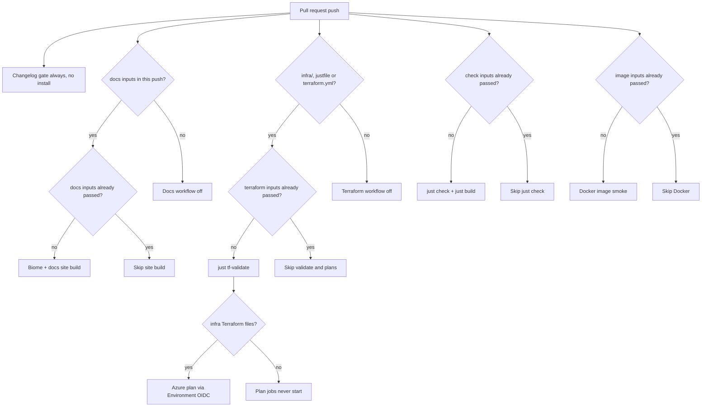
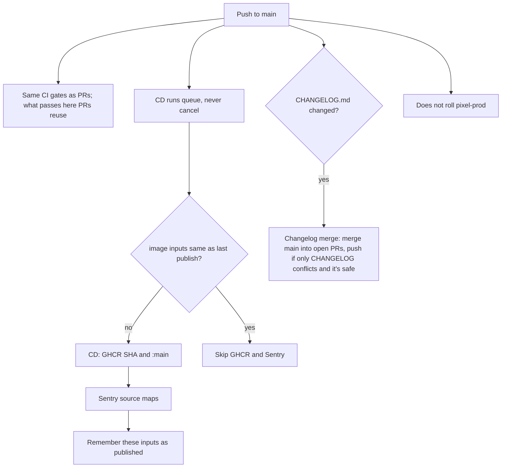
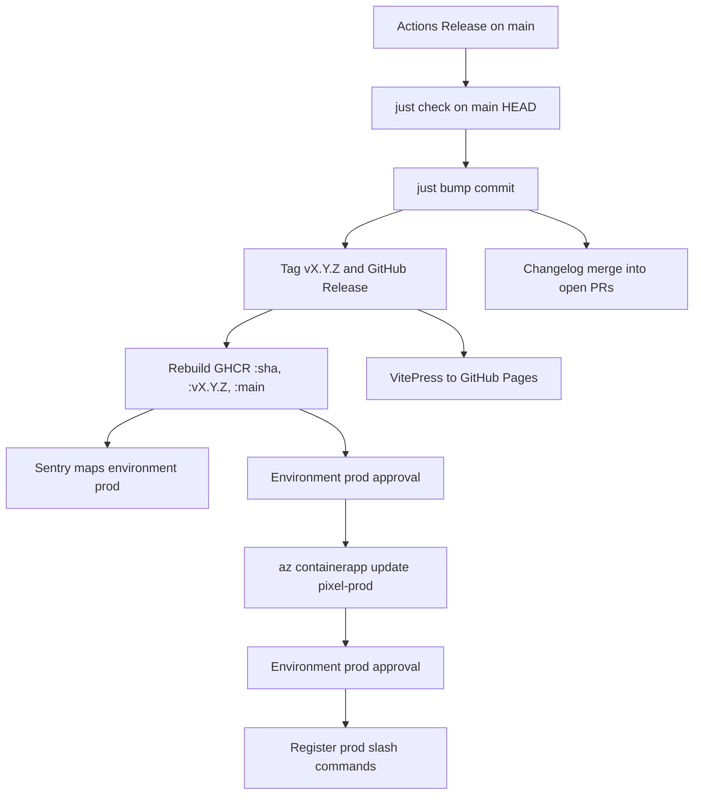

# Operations runbook

How to run Pixel day to day and what to do when something goes wrong. It is written for volunteers: anyone with the right access should be able to follow it without the original author.

**This is a living document.** Bootstrap (#8) is applied. Container App `pixel-dev` is live (#9). `infra/envs/prod` is in repo (#12). CD: `just deploy-dev` rolls Azure `dev`; merges to `main` publish GHCR when the image inputs differ from the last publish. Prod and the docs site ship from the Release workflow. Every procedure has two parts:

- **Today:** what works now, with Pixel run locally or in a container you start yourself. Everything here has been checked against the code.
- **🚧 Azure:** a marker for the steps that still depend on hosting that is not applied, or on #12. Search for `🚧` to find what's left.

Before you change anything on **prod**, read "Rules of thumb" below.

## Contents

- [Rules of thumb](#rules-of-thumb)
- [Who and what](#who-and-what)
- [Quick reference](#quick-reference)
- [Infra overview](infra.md) (diagrams)
- [Running Pixel today](#running-pixel-today)
- [Adding Pixel to a Discord server](#adding-pixel-to-a-discord-server)
- [Access lists](#access-lists)
- [Moderation](#moderation)
- [Home Assistant](#home-assistant) (setup and threat model: [`home-assistant.md`](home-assistant.md))
- [Terraform bootstrap](#terraform-bootstrap)
- [Azure Container App (`dev`)](#azure-container-app-dev)
- [Closing-time](#closing-time)
- [Mastodon](#mastodon)
- [Space state](#space-state)
- [Secrets](#secrets) ([sync with Key Vault](#sync-secrets-with-key-vault), [pull and push an environment](#pull-and-push-an-environment))
- [Deploys](#deploys)
- [CI and CD](#ci-and-cd)
- [Changelog and versions](#changelog-and-versions)
- [Incidents](#incidents)
- [Sentry](#sentry)
- [Privacy requests](#privacy-requests) ([privacy notice](privacy.md))
- [Disaster recovery](#disaster-recovery)
- [Keeping this up to date](#keeping-this-up-to-date)

## Rules of thumb

1. **Try it in dev first.** Dev has its own bot, token and guild. Prod is the real Pixelbar server.
2. **Never run two instances against one bot token.** Every command would be answered twice. Check that nothing else is running before you start one.
3. **Never paste a secret into chat, an issue, a pull request or a log.** Tokens go in the secret store (or your local `.env`) and nowhere else. If one leaks, rotate it now (see [Secrets](#secrets)) and tell the others.
4. **Identify people by ID, never by name.** Names and nicknames can be changed or faked. The ID can't.
5. **Pixel fails closed.** A missing or broken access file stops it from starting, on purpose: that is a loud outage, never "everyone is a guest". Fix the file; don't work around it.

## Who and what

| | |
| --- | --- |
| **Environments** | `dev` (Pixel Dev bot, test guild) and `prod` (production Pixel bot, production guild). Separate bots, tokens and secrets. Never copy the Dev token into prod. |
| **Who is on the hook when the bot is down** | 🚧 Not decided. Put a named contact (and a backup) here, and where to reach them. |
| **Where Pixel runs** | Azure `pixel-dev` (one replica, no public ingress) plus `pixel-prod` after a maintainer apply, plus any laptop `just dev`. Subscription `d150e252-e2f0-47fb-8a4a-c3f29e9aebd4`, West Europe. Resource groups `pixel-bootstrap`, `pixel-dev`, `pixel-prod`. `just deploy-dev` rolls `pixel-dev`. **Do not** also run `just dev` on the Pixel Dev token while that app is up. A Release rolls `pixel-prod` after Environment `prod` approval. Diagrams: [`infra.md`](infra.md). |
| **Where the code and CI are** | GitHub, `pixelbar/pixel`. CI runs `just check` and/or a Docker smoke build only when the files those jobs depend on have not already passed. Docs PRs run Biome + the site build. CD on `main` publishes `ghcr.io/pixelbar/pixel:<sha>` when the image inputs differ from the last publish. |
| **Access you may need** | The Discord Developer Portal (bot token), a Discord role that can manage the server, the Sentry project, the GitHub repo, the Home Assistant admin account, Owner on the Pixel Azure subscription (to apply bootstrap), and the host. |

## Quick reference

| I want to… | Do this |
| --- | --- |
| See when Pixel last started, crashed or stopped, and which version | The announcements channel: a "🟢 Pixel is online" post per run (version, commit, **Where** `local` or `cloud`), edited to "🔴 offline" on shutdown, or marked "⚠️ stopped unexpectedly" after a crash |
| See if Pixel is up and which version | `/ping` in Discord, or `/admin status` (version, **Where** `local` or `cloud`, Node, uptime, access list counts, Discord roles, Home Assistant) |
| Check readiness from outside | `GET /healthz` (process is up) and `GET /readyz` (200 only while the Discord gateway is connected, otherwise 503), on `HEALTH_PORT` (default 8080) |
| Read the logs | Console, or the file `data/logs/current.log` (JSON lines, about two weeks kept), or **Logs** in Sentry |
| See what Pixel stores about people | [Privacy notice](privacy.md). Handle a request under [Privacy requests](#privacy-requests) |
| Set up Home Assistant on a test instance | [`home-assistant.md`](home-assistant.md) |
| A door action looks wrong | [If a door action looks wrong](#if-a-door-action-looks-wrong) |
| Re-read the access lists and devices after a hand edit | `/admin reload` (admins only). Or restart |
| Check the config files without starting Pixel | `just validate-config` |
| Make Discord pick up new or changed commands | Prod: a Release does it (the `register-prod` job, after a second Environment `prod` approval). Dev: `just deploy-dev` does it. By hand (rollbacks, or before `github_register_principal_id` is applied): `just register dev` or `just register prod`. Prod uses `.env.prod` (`PIXEL_ENV=prod`), never the Mini Pixel Dev token |
| Add Pixel to a Discord server | [Adding Pixel to a Discord server](#adding-pixel-to-a-discord-server) |
| Turn closing-time posts on or off, or change the text | [Closing-time](#closing-time) |
| Look up a person | `/admin level get user:` (admins only) |
| See what changed between versions | [`CHANGELOG.md`](../CHANGELOG.md) |
| Cut a production release | GitHub → Actions → **Release** → Run workflow on `main` |

Useful `just` recipes: `just dev`, `just check`, `just validate-config`, `just check-changelog`, `just bump`, `just register dev`, `just register prod`, `just sentry-release`, `just command-access dev`, `just docker-build`, `just deploy-dev`, `just tf-validate`, `just tf-plan prod`. Run `just` to list them all.

## Running Pixel today

**Azure `dev` is live** (`pixel-dev`, one replica). Prefer `just deploy-dev` for that bot. If `pixel-dev` is up, do **not** also `just dev` on the same Pixel Dev token (two bots would both answer).

To run Pixel from a laptop (your own bot, or the Pixel Dev bot only when the Azure app is stopped):

**From source** (needs Node.js and pnpm):

```sh
just install
cp .env.example .env            # then fill in the values
cp config/admins.example.yaml config/admins.yaml     # then edit both files
cp config/members.example.yaml config/members.yaml
just validate-config            # must say OK
just register dev               # once, and after command changes; prod: just register prod
just dev                        # or `just start` after `just build`
```

**In a container:**

```sh
just docker-build                                  # tags pixel:local, version = the git SHA
docker run -d --name pixel \
  --env-file .env \
  -v "$PWD/config:/app/config" \
  -v "$PWD/data:/app/data" \
  -p 8080:8080 pixel:local
```

Mount the **config directory writable**: `members.yaml` is changed by admin commands (written to a temp file next to it, then renamed, with the previous copy kept as `members.yaml.bak`). `data/` holds state and the log files. **`data/schedules.yaml` is not safe to delete** (it is the scheduled posts). The rest of `data/` is. See [`architecture.md`](architecture.md) for every setting.

Only ever run one copy. Before starting one: `docker ps`, and check nobody else has Pixel running with the same token.

**Azure (`dev`, after apply):** Container App `pixel-dev` in resource group `pixel-dev`. Secrets from Key Vault `pixel-dev-kv`. `admins.yaml` is a read-only Key Vault file. `members.yaml`, Home Assistant files and `data/` (including `schedules.yaml`) live on Azure Files share `pixel` on account `pixeldevdata`, mounted at `/app/persist`. How to apply, seed files, and restart: [Azure Container App (`dev`)](#azure-container-app-dev). Do not start a local Pixel on the same token while that app is up.

## Adding Pixel to a Discord server

Pixel serves **one guild per bot**. `DISCORD_GUILD_ID` is that guild. The running process leaves every other server (`discord.foreign_guild`). Dev (Pixel Dev) stays on the test guild. Prod is a **separate Discord application** in its own guild. Do not invite Pixel Dev into the production server and expect it to stay.

The URL `just command-access` prints is **not** an invite. It is user OAuth (`applications.commands.permissions.update` only) so admins can see `/admin`. Authorising it never adds a bot member. See [`discord-command-visibility.md`](discord-command-visibility.md).

**Invite (prod or a new test bot):**

1. Developer Portal → the right application (prod is not Pixel Dev) → **Bot**. Public Bot as you need it. **Require OAuth2 Code Grant** off. Guild install, not user install.
2. OAuth2 → URL Generator: scopes **`bot`** and **`applications.commands`**. Permissions to request: View Channel, Send Messages, Embed Links, Read Message History, plus Send Polls if you use `/schedule`, plus Manage Roles only if you set `DISCORD_ROLE_MEMBER` / `DISCORD_ROLE_FRIEND`. Open the URL, pick the server (you need Manage Server), authorise. Confirm the bot is in **Members**.
3. Put that application ID in `DISCORD_APP_ID` and the server ID in `DISCORD_GUILD_ID` (gitignored `.env` for local, gitignored `terraform.tfvars` for Azure). Channel IDs must be in **this** guild.
4. `just register dev` or `just register prod` against that env’s token and guild. Optional: add redirect `http://localhost:53682/callback`, then `just command-access` for the same env.
5. Start **one** instance. Never two processes on one token.

Shape: `https://discord.com/oauth2/authorize?client_id=<DISCORD_APP_ID>&scope=bot%20applications.commands&permissions=<bits>`. No `response_type` or `redirect_uri` on a bot invite.

## Access lists

Tiers come from two files: `config/admins.yaml` (hand-edited) and `config/members.yaml` (changed by admin commands, and safe to edit by hand). Read [`identity-and-access.md`](identity-and-access.md) before changing either.

**Add or change a member or friend (the normal way):**

1. In Discord, an admin runs `/admin level set user:<person> level:<member|friend|guest>` with an optional reason.
2. Check it with `/admin level get user:<person>`.

That's all: Pixel updates `members.yaml` itself, keeps `members.yaml.bak`, and logs an `access.changed` event with who did it. If Pixel is configured to mirror Discord roles, it also sets the person's role. `/admin sync` re-applies the roles for everyone if they ever drift.

**Remove someone completely:** `/admin level set … level:guest` keeps their entry. To delete the entry, edit `members.yaml` by hand (remove the whole `- ids: …` block), then `/admin reload`. Admins can't be changed from Discord (see below).

**Add or remove an admin:** admins are never changed from Discord. Edit `config/admins.yaml` by hand, and make sure every admin also has an entry in `members.yaml` with the same IDs. Then run `just validate-config` and `/admin reload` (or restart). Admin IDs must be quoted strings like `"discord:123456789012345678"`. Getting an ID: in Discord, enable Developer Mode, right-click the person, **Copy User ID**.

**If you edited a file and Pixel won't start:** run `just validate-config`. It names the file, the position and the field, never the value. Fix that and start again. A bad `admins.yaml` or a missing admin list is a startup failure by design. `members.yaml.bak` is the previous good copy if you need to go back.

**Capabilities** (extra permissions such as `ha-lights`): `/admin capabilities grant|revoke user: capability:`, `/admin capabilities grant-all user:` (every capability in one audited change) and `/admin capabilities list [user:]`. They only ever work for members, friends and admins, never guests. A real grant or revoke also DMs the person, naming the capability. If they have DMs from server members closed, the change still applies; look for `capability.dm_failed` in the logs (IDs, not the message text).

**Azure (`dev`):**

- **`admins.yaml`:** Key Vault secret `admins-yaml`, mounted read-only. `just secrets-pull dev` writes it to `config/admins.dev.yaml`; edit that, then `just secrets-push dev`, which checks it against the env's `members.yaml` and offers the restart (see [Sync secrets with Key Vault](#sync-secrets-with-key-vault)). Versions of the secret are history.
- **`members.yaml` and Home Assistant files:** on the Azure Files share. Admin commands already rewrite `members.yaml` in place. A hand edit: upload the file to the share (see [Azure Container App (`dev`)](#azure-container-app-dev)) then `/admin reload`, or restart. Daily backups of the share keep 14 days.
- Prod (#12) will be the same layout in `pixel-prod`.

## Moderation

**Find what someone did.** Pixel logs every command, denial and rate limit with the person's stable ID. Search by ID, never by name:

```sh
# from the log file (JSON lines): what did discord:123456789012345678 do?
jq -c 'select(.user == "discord:123456789012345678")
       | {time: (.time/1000|todate), event, command, outcome, reason, msg}' data/logs/*.log
```

The events to look for: `command.executed` (with `outcome`), `command.denied`, `command.rate_limited`, `access.changed`, and for Home Assistant `home.action` and `home.action_denied`. In Sentry, open **Logs** and filter on the `user` attribute (`discord:<id>`), or look at the issue's user. The names in the logs (`userName`, `userHandle`) are there so you can recognise the person, but act on the ID.

**Stop someone using Pixel.** Pixel has no block list of its own (#6 decided Discord's own moderation covers it):

1. **Ban or time them out in Discord** (Server Settings → Members). A banned person can't use any command.
2. If they were a member or friend, run `/admin level set user:<person> level:guest`, and revoke any capabilities with `/admin capabilities revoke`, so nothing lingers if they come back.
3. Note what you did and why.

If you suspect someone's **account was taken over** (for example it is unlocking things or running device actions it never used to), do 1 and 2 at once, then check the logs for what it did, and tell the board.

## Home Assistant

First-time setup (dedicated non-admin user, token, URL, devices file) and the threat model: [`home-assistant.md`](home-assistant.md). Why those choices: [ADR 0011](adr/0011-home-assistant.md).

Pixel talks to Home Assistant (HA) with a long-lived token from a **non-admin** HA user, and can only touch the devices in `config/home-assistant/devices.yaml` (read [`architecture.md`](architecture.md), "Home Assistant"). `/admin status` shows whether it's connected, and how many devices are allowed.

**Add or remove devices on Azure:** `just ha-devices dev` (or `prod`). It pulls that env's `devices.yaml` from the file share, shows everything Home Assistant has with what's already listed ticked (marked `[listed as …]`, first). Tick to add a device, untick to remove one. Press `/` to search, ⏎ to keep the filter, `s` to see every ticked device, and esc to go back; ticks survive searches. Listed devices Home Assistant no longer offers are shown too, so they can be removed. For each new device it asks: the name, the actions (none means read-only) and `minTier`. It validates the result, shows the diff, and uploads it only when you say yes and nobody changed the remote meanwhile. Then run `/admin reload` in that env. The remote is the truth: the tool keeps a local copy in `config/home-assistant/<env>/devices.yaml`, and if that copy has edits the remote lacks, it shows them and stops (or throws them away if you say so). It needs `az login` and `HOME_ASSISTANT_URL` / `HOME_ASSISTANT_TOKEN` in `.env.dev` (or `.env`) or `.env.prod`. Doors start with no actions ticked, and on dev it offers none, because dev must not control the real doors. A leftover `inventory.yaml` on a share (older Pixel versions wrote it) is not used and can be deleted.

**Add a device by hand:** write an entry in `devices.yaml` (the entity ID is on the entity's page in Home Assistant), and set who may use it (`minTier`) and which `actions` are allowed (none means read-only). Run `just validate-config`, then `/admin reload`: the reply says how many devices there are and warns about entities HA doesn't know. Nothing is usable until it's in `devices.yaml`.

**Take a device away from people quickly:** remove its `actions` (or the whole entry) from `devices.yaml` and `/admin reload`. Changing it back is the same in reverse.

**Doors:** members with `ha-doors` (or `ha-admin`) can lock or unlock a door with `/ha set`, or unlock with `/ha open door:`. Pixel never unlatches (`open` / `lock.open`); drop `open` from `devices.yaml` if it's still listed, or `just validate-config` refuses the file. A door can't be opened to friends: `just validate-config` refuses a door with `minTier: friend`.

**Stop all door control at once:** `/admin doors off` (admins only). Nobody can then act on any door from Pixel until an admin runs `/admin doors on`. It survives restarts. Check it in `/admin status`. If the switch file in `data/` is ever unreadable, doors start off and say so in the logs; `/admin doors on` fixes it.

**Emergency stop for everything:** revoke Pixel's token **in Home Assistant** (profile of the Pixel user → Security → Long-lived access tokens → delete). Pixel's next call is refused and the connection turns off. It takes effect at once and doesn't depend on Pixel being healthy. To bring it back, make a new token and put it in `HOME_ASSISTANT_TOKEN` (see [Secrets](#secrets)).

### If a door action looks wrong

Someone unlocked (or locked) a door who shouldn't have, a door moved when nobody asked, or `/ha` reported a result that doesn't match the physical door.

1. **Stop Pixel's door control now:** `/admin doors off`. That is enough if the problem is only Pixel. It does not lock the physical door.
2. **If anything still moves,** or you don't trust the Home Assistant user: delete Pixel's long-lived token in HA (emergency stop above). That stops every Pixel action, not only doors.
3. **Check the physical door** and, if you can, Home Assistant's own logbook for that lock.
4. **Find who Pixel thinks did it.** Search the logs for `"kind":"door"` and `home.action` / `home.action_denied` (see [Moderation](#moderation)). Act on the Discord ID, never the name. A matching nickname is not evidence.
5. **If that Discord account looks taken over:** Discord ban or timeout, `/admin level set` to guest, revoke `ha-doors` and `ha-admin` (see [Moderation](#moderation)). Keep doors off until you know they can't do it again.
6. **If the token or the HA admin looks leaked:** rotate the Home Assistant token (and the HA admin password) as in [Secrets](#secrets). Treat a leaked HA admin as a building incident, not only a Pixel one.
7. Tell the board what you stopped, which ID you found, and whether the physical door was open.

**If Home Assistant is unreachable:** see [Incidents](#incidents).

**How Pixel reaches HA:** locally, `HOME_ASSISTANT_URL` is usually the Nabu Casa cloud URL. On Azure the preferred path is a Tailscale sidecar so the container talks to HA on the LAN (#9, #43). A Nabu Casa URL still works if the sidecar is not there yet.

## Terraform bootstrap

`infra/bootstrap` (#8) is applied. It does **not** run Pixel. It created remote Terraform state and GitHub → Azure login without a client secret.

**Who can apply:** Owner on subscription `d150e252-e2f0-47fb-8a4a-c3f29e9aebd4`. Later changes: [`infra/bootstrap/README.md`](../infra/bootstrap/README.md).

**GitHub Environment `prod`** (reviewers, branch `main`) needs `ARM_CLIENT_ID`, `ARM_TENANT_ID` and `ARM_SUBSCRIPTION_ID` as **variables**, not secrets. Values: [`infra/bootstrap/README.md`](../infra/bootstrap/README.md). Azure `dev` uses local `az` (`just tf-apply dev`, `just deploy-dev`). Terraform plan on PRs uses Environment `dev` / `prod` `ARM_*` and **fails closed** if they are missing. The prod plan runs with `-refresh=false`: GitHub is not Key Vault Secrets User on `pixel-prod-kv` (ADR 0012; since ADR 0014 it may read the `discord-token` secret only), so refreshing the other secrets in state would fail with 403. It plans with the example tfvars, so it shows the Key Vault secrets being removed; that is expected and it never applies. Before applying prod, run `just tf-plan prod` locally for the real plan. Coding agents must not apply prod.

**Do not** apply bootstrap from GitHub Actions, and do not run a second Pixel bot against the same Discord token.

## Azure Container App (`dev`)

Terraform: `infra/modules/pixel` + `infra/envs/dev` (#9). **Do not apply until a maintainer says so.** Steps, secret names, volume layout and tear-down: [`infra/envs/dev/README.md`](../infra/envs/dev/README.md).

```sh
just tf-validate
just tf-plan dev
just tf-apply dev    # only when told; does not roll the running image
```

The first apply after #73 **moves** the Container App address (`azurerm_container_app.this` → `this[0]`). That is not a replace and does not change the running image. Plan should say "has moved", not destroy/create.

After apply, Discord still will not answer until Key Vault secrets exist (app secrets with `just secrets-push dev`; Terraform never writes them, [ADR 0017](adr/0017-one-writer-for-app-secrets.md)), `members.yaml` is on the share, an image exists, commands are registered, and nothing else is using that bot token.

**On `dev`, the image is owned by `just deploy-dev`, not by apply** ([#73](https://github.com/pixelbar/pixel/issues/73), [ADR 0010](adr/0010-ghcr-cd.md)). First create uses `container_image` (default `:main`). After that, Terraform **ignores** the Pixel container image on the **dev** app only. A later `just tf-apply dev` still updates vault, volume, env and the replica pin; it does **not** roll the bot back to a stale SHA in gitignored `terraform.tfvars`. Do not apply Terraform from CD to "fix" that drift. Do not bump `container_image` expecting a **dev** apply to change what is running.

**Prod** is `azurerm_container_app.managed`: apply **will** set `container_image`. Do not copy the dev ignore onto prod. Coding agents must not apply prod (`PIXEL_APPLY_PROD=1`).

- **Change the running `dev` image:** `just deploy-dev`, or `az containerapp update -g pixel-dev -n pixel-dev --image ghcr.io/pixelbar/pixel:<sha> --min-replicas 1 --max-replicas 1`.
- **See what is running:** `az containerapp show -g pixel-dev -n pixel-dev --query "properties.template.containers[0].image" -o tsv`
- Keep min=max replicas = 1.

**Restart the app** (after rotating a secret or changing `admins.yaml`):

```sh
just restart dev
```

That restarts the running revision (`az containerapp revision restart`); it doesn't deploy anything. `just restart prod` does the same for `pixel-prod`.

**See that there is exactly one replica:** `az containerapp replica list -g pixel-dev -n pixel-dev -o table`. If a command is answered twice, stop the extra instance (a laptop, or an old revision). Never raise `max_replicas`. Overlap during a deploy is #11.

**Home Assistant:** Tailscale sidecar is preferred (`tailscale_enabled = true` plus Key Vault `tailscale-auth-key`). A Nabu Casa URL in `home_assistant_url` plus `home-assistant-token` still works when Tailscale is off. Set both URL and token, or neither. Dev must not point at the real doors.

**Rough cost:** about €40–55/month for always-on `dev` without Tailscale, plus about €15 with the sidecar. West Europe. Not a quote.

**Prod** (`infra/envs/prod`, #12): a maintainer applies with `PIXEL_APPLY_PROD=1 just tf-apply prod` after a **separate** Discord application, prod Key Vault secrets, and access lists exist. Coding agents must not apply prod. `just deploy-dev` still rolls only `pixel-dev`. Merges to `main` publish GHCR only. A [Release](../.github/workflows/release.yml) cuts the version and, after Environment `prod` approval, rolls `pixel-prod` (`az`, min=max=1, no Terraform apply). The Release then registers prod commands (ADR 0014) once a maintainer has applied `github_register_principal_id`; until then, `just register prod` (`.env.prod`), never the Mini Pixel Dev token. Steps: [`infra/envs/prod/README.md`](../infra/envs/prod/README.md).

## Scheduled posts

Members with the `schedule-posts` capability schedule messages and polls with `/schedule` (`/admin capabilities grant user: capability:schedule-posts`). `/schedule list` shows them all, with who made each in the file.

After a deploy that adds `/schedule`, run **`just register dev`** or **`just register prod`** so Discord lists the commands, then grant the capability. No new environment variables: times use `PIXEL_TIMEZONE` (Europe/Amsterdam). The bot needs Send Messages in the target channel, and Send Polls if it will post polls.

- **They live in `data/schedules.yaml`.** Back it up with the access files; deleting it deletes every schedule.
- **Tokens** in the message, poll question or answers (`{{date}}`, `{{day}}`, `{{month}}`, `{{year}}`, `{{dateWithTime}}`) fill in when the post goes out, in `PIXEL_TIMEZONE`. A whole-day offset (`{{date+2}}`, `{{day+2}}`) is from the scheduled day, so a Monday post can say Wednesday. A name Pixel doesn't know is left as written. Discord's limits (2000 characters for a message, 300 for a poll question, 55 for an answer) count the filled text, so `/schedule` refuses a post its tokens would push over. `schedule.clipped` in the logs means one still came out too long and was cut to fit. Don't put secrets in a scheduled post.
- **Change one before it posts:** `/schedule edit` (only the person who scheduled it). Without a schedule it lists theirs; with one it opens the same compose modal, prefilled. One-offs that already went out, and other people's schedules, get a generic refusal.
- **Stop one now:** `/schedule pause` or `/schedule delete`. To stop someone's schedules, revoke their capability: each of theirs pauses the next time it's due.
- **A post didn't go out:** look in the logs for `schedule.failed` (Pixel can't post there any more: permissions, a deleted channel), `schedule.skipped` (Pixel was down more than an hour past the time) or `schedule.paused_no_access`. Pixel never retries a failed post; the next occurrence tries again.
- **If the file is invalid** (a bad hand edit), nothing is posted or changed, and `/schedule` says so. Fix it or restore it from backup, then restart. Pixel never overwrites it while it's invalid.

## Closing-time

Members can post a closing-time reminder with `/closing-time`, and Pixel posts the same message automatically after a confirmed space-closed announcement. Both paths no-op if posting is off.

**After a deploy that adds `/closing-time`, run `just register dev` or `just register prod`** so Discord lists the command.

| I want to… | Do this |
| --- | --- |
| Turn it on | Set `DISCORD_CLOSING_TIME_CHANNEL_ID` to the Discord channel ID (local `.env`, or the Container App env). The bot needs View Channel, Send Messages and Embed Links there |
| Turn it off | Unset the variable, or set it to `off` or `none`. `/closing-time` then says so privately; the automatic path logs `closing_time.disabled` and does not fail space-close |
| Change the text | `/admin closing-time set` (opens a modal, prefilled when a message is already saved). Pixel writes `data/closing-time.md` on the persist volume (Azure Files share on cloud — that write *is* the sync; there is no extra copy). You can still edit the file by hand. A missing or empty file uses a built-in default. No restart needed. `{{date}}` and the other date tokens fill in when it is posted. **Never put door codes, wifi passwords or personal data in it** |
| Change where open/closed is announced | `/admin announcements set` (a style and a channel), `remove`, `list`. It takes effect at once and is saved in `data/announcement-routes.yaml` on the persist volume. There is no environment setting for this; moving Pixel to another share means copying that file with the rest of `data/`. After deploying a version that adds the command, run `just register dev` / `just register prod`. **Upgrading from `DISCORD_ANNOUNCE_LIVE_CHANNEL_ID` / `DISCORD_ANNOUNCE_TIMELINE_CHANNEL_ID`:** those are gone and ignored, so set the same channels again with `/admin announcements set` right after the deploy, or open/closed announcements stop. A route whose channel was deleted or lost permissions stays on the list with the reason (and is reported to Sentry at startup): fix the channel and `set` it again |
| See that it posted | The configured channel: a "Closing time" embed, mentions disabled |
| Discord lists `/closing-time` but Pixel says it doesn't know it, or shows an error and then the reminder still posts | Another instance is on this bot token. Stop the extra one (see [Incidents](#incidents)), then retry |

The destination is a channel ID on purpose: do not hard-code a Discord channel in the code.

## Mastodon

Pixel can toot announcements to a configured Mastodon account. It is **outbound only**: it never reads mentions, replies or DMs. Features do not change — they still hand a typed announcement to the announcer. No instance or account is hard-coded.

**Turn it on** (local `.env`, or the Container App env plus Key Vault for the token):

1. On the instance, create an application (Preferences → Development → New application). Name it something like `Pixel`. Scopes: **`write:statuses` only**. Do not enable read, follow or admin scopes.
2. Mark the account as a bot and follow that instance's rules for automated accounts.
3. Set `MASTODON_INSTANCE` to the instance origin (`https://mastodon.example`) and `MASTODON_ACCESS_TOKEN` to the access token. Set both or neither.
4. Optional: `MASTODON_ACCOUNT` (public handle, logs only), `MASTODON_VISIBILITY` (`unlisted` default, or `public` for the local timeline), `MASTODON_ANNOUNCE_KINDS` (default `space.status`; add `closing.time` or `bot.status` if you want those too; `off` / `none` turns toots off).
5. Restart Pixel. A line `publisher ready` with `publisher: mastodon` means it registered. The first confirmed space open or close should appear on the account.

**Turn it off:** unset `MASTODON_INSTANCE` and `MASTODON_ACCESS_TOKEN` (or set `MASTODON_ANNOUNCE_KINDS` to `off`). Discord is unchanged.

**Emergency stop:** revoke the application token on the instance. The next toot is refused, reported to Sentry (`announcer:mastodon`), and Discord still works.

The token is a secret. Never put an instance URL or handle in the code; never put the token in a chat, an issue or a log.

## Space state

Members with the `spacestate` capability can set the space open or closed with `/spacestate set state:open|close`. Pixel POSTs to the space's state API with the user and token, and expects `SUCCESS` back.

**Turn it on** (local `.env`, or the Container App env plus Key Vault for the user and token):

1. Set `SPACESTATE_API_URL` to the API address, and `SPACESTATE_USER` and `SPACESTATE_TOKEN` to the credentials it expects. Set all three or none: setting only some stops startup.
2. On Azure, first put `SPACESTATE_USER` and `SPACESTATE_TOKEN` in `.env.<env>` and `just secrets-push <env>`, which creates the Key Vault secrets `spacestate-user` and `spacestate-token`. Then set `spacestate_api_url` in the environment's `terraform.tfvars` and apply. Terraform only references the two secrets; it never writes them.
3. Optional: if the API needs extra request headers, set `SPACESTATE_ADDITIONAL_HEADERS` to a JSON object such as `{"X-Example": "value"}`. It is a secret so the values stay out of the public repository. On Azure, push it with `just secrets-push <env>` (Key Vault secret `spacestate-additional-headers`) first, then set `spacestate_additional_headers_enabled = true` and apply.
4. Restart Pixel, then run `just register dev` (or `prod`) so Discord shows `/spacestate`.
5. An admin grants the capability: `/admin capabilities grant user: capability:spacestate`. Being an admin is not enough.
6. Try `/spacestate set state:open`, then check `/status`. Pixel follows the state it reads back from SpaceAPI, so the change is announced the usual way.

**Turn it off:** unset all three variables (on Azure, unset `spacestate_api_url`). The command stays but says it isn't set up. To stop one person, revoke their capability.

**If it fails:** the person is told nothing changed, and Sentry gets an event tagged `spacestate` with a message such as "did not accept the change" (the API answered something other than `SUCCESS`), "responded with HTTP 403" (wrong user or token) or "request failed" (unreachable). The message never has the URL, the token or the API's answer. Check the credentials first. Pixel never retries.

**See the request and response:** in Sentry, a failed `/spacestate set` event has a `spacestate_api` section (Contexts), and every call, successful or not, has the same fields as `spacestate_api.*` attributes on the `spacestate` command's trace. They hold the address without its query (the user and token are never shown), the state sent, the HTTP status, content type and length, the response body (control characters removed, cut to 1,024 characters, and left out entirely when over the 4 KiB cap or unreadable), the outcome (`success`, `rejected`, `http-error`, `too-large`, `unreadable` or `network-error`) and how long it took. For a `network-error` they also name why when the underlying error says (`errorCause`: a code such as `ENOTFOUND` or `ECONNREFUSED`, or `UNEXPECTED_REDIRECT` when the API answered with a redirect, which Pixel refuses because the token is in the URL). Request headers, including `SPACESTATE_ADDITIONAL_HEADERS`, are never sent. Without a Sentry DSN nothing is collected.

The user and token are in the URL's query string, so treat anything that could hold the whole URL (a proxy log, a copy of the settings) as a secret.

## Secrets

Every secret lives in the secret store for its environment (a local `.env` for development, Key Vault `pixel-dev-kv` in Azure `dev`) and nowhere else. Pixel never logs them, and scrubs anything shaped like a Discord or Home Assistant token from logs and Sentry, but don't rely on that. After rotating, **restart Pixel**: secrets are read once at startup.

| Secret | Where it comes from | Rotate when |
| --- | --- | --- |
| `DISCORD_TOKEN` | Discord Developer Portal; Key Vault `discord-token` | It may have leaked, someone with access leaves, or on a schedule |
| `HOME_ASSISTANT_TOKEN` | A long-lived token in HA; Key Vault `home-assistant-token` | It may have leaked, or the Pixel user changes |
| `MASTODON_ACCESS_TOKEN` | Instance Development app (`write:statuses`); Key Vault `mastodon-access-token` when hosted | It may have leaked, the app is rotated, or you move instance |
| `SPACESTATE_USER`, `SPACESTATE_TOKEN` | Whoever runs the space state API; Key Vault `spacestate-user` and `spacestate-token` when hosted | They may have leaked, or the API's credentials change |
| `SENTRY_DSN` | Sentry project settings; Key Vault `sentry-dsn` | It's being abused, or you move projects |
| Tailscale auth key | Tailscale admin; Key Vault `tailscale-auth-key` | It may have leaked, or you rotate tagged keys |
| `admins.yaml` | Hand-edited; Key Vault `admins-yaml` (not a token) | When admins change |

**The list of secrets** lives in [`infra/secrets.manifest.yaml`](../infra/secrets.manifest.yaml) ([ADR 0015](adr/0015-secrets-manifest.md)): Key Vault name, environment variable, what turns it on. Names only, never values. `just validate-secrets` checks it and prints the list. Terraform builds the vault's secrets and the Container App's secret environment variables from it, and `just check` fails if `src/config.ts`, `.env.example`, the Terraform variables or these docs disagree with it. To add a secret: add an entry to the manifest, its ephemeral and sensitive Terraform variable (module, `envs/dev`, `envs/prod`) and write-only entry in `infra/modules/pixel/secrets.tf`, the setting in `src/config.ts`, `.env.example` and the architecture config table, and a row in the table above; the test names anything you miss.

**Rotate the Discord bot token** (the old one stops working the moment you reset it, so expect a short outage):

1. Discord Developer Portal → the right application (dev or prod!) → **Bot** → **Reset Token**. Copy it once; it isn't shown again.
2. Put it in the secret store as `DISCORD_TOKEN`.
3. Restart Pixel. Check `/ping`, and that `/readyz` is 200.
4. You don't need `just register`: the application and its commands haven't changed.

**Rotate the Home Assistant token:**

1. In HA, as the **non-admin** Pixel user: Profile → Security → Long-lived access tokens → create a new token, then delete the old one.
2. Put the new one in the secret store as `HOME_ASSISTANT_TOKEN`, and restart Pixel.
3. `/admin status` should say Connected with no warning about an admin token. If it warns that the token belongs to an admin, the token is from the wrong user: redo it with the non-admin user.

**Rotate the Mastodon token:**

1. On the instance: Preferences → Development → the Pixel application → regenerate or create a new application with **`write:statuses` only**. Copy the access token once.
2. Put it in the secret store as `MASTODON_ACCESS_TOKEN`, and restart Pixel.
3. The next space open or close should appear on the configured account. If Sentry shows `announcer:mastodon` with HTTP 401, the token is wrong or revoked.

**Rotate the space state credentials:**

1. Get the new user and token from whoever runs the API.
2. Put them in the secret store as `SPACESTATE_USER` and `SPACESTATE_TOKEN`, and restart Pixel.
3. Run `/spacestate set` with the state the space is already in. If Sentry shows `spacestate` with HTTP 401 or 403, the credentials are wrong.

**Rotate the Sentry DSN:** Sentry project → Settings → Client Keys: create a new key, disable the old one, update `SENTRY_DSN`, restart. Check that a test event arrives.

**If a secret leaked:** rotate it first, then work out where it leaked from. Check the logs and Sentry for the time window. A leaked Discord token lets someone act as the bot in your server, so treat it as urgent.

**Azure:** "put it in the secret store" means `just secrets-push dev` (or `prod`), below, which also offers the restart. It is the only thing that writes app secrets; Terraform's `write_secrets` writes only the Tailscale key and the registry token ([ADR 0017](adr/0017-one-writer-for-app-secrets.md)). Never commit secret values.

### Sync secrets with Key Vault

`just secrets-pull` and `just secrets-push` keep an environment's **app** secrets (the `app` group in the manifest: Discord token, `admins.yaml`, Home Assistant, Mastodon, space state, Sentry) in step between its Key Vault and your laptop ([ADR 0016](adr/0016-secrets-sync.md)). It is their **only** writer: Terraform references them from the Container App but never writes them ([ADR 0017](adr/0017-one-writer-for-app-secrets.md)). The Tailscale key and the registry token are `infra` secrets: Terraform owns them (`write_secrets`) and the tool never touches them.

| Env | Key Vault | Local env secrets | Local `admins.yaml` | Container App |
| --- | --- | --- | --- | --- |
| `dev` | `pixel-dev-kv` | `.env.dev` | `config/admins.dev.yaml` | `pixel-dev` |
| `prod` | `pixel-prod-kv` | `.env.prod` (must set `PIXEL_ENV=prod`) | `config/admins.prod.yaml` | `pixel-prod` |

These local files are gitignored and written readable only by you. **You need:** `az login` on the Pixel subscription, **Key Vault Secrets Officer** on the vault (Secrets User is enough to pull), and the same storage access as `just ha-devices` (a push reads `members.yaml` from the share to check `admins.yaml`).

**Change a secret:**

1. `just secrets-pull dev`. It reads every app secret from the vault and writes it into `.env.dev` (only those keys; the rest of the file stays as it is) and `config/admins.dev.yaml`. If one of your local values differs from the vault, it lists which and asks before overwriting, so an edit you haven't pushed isn't lost by accident.
2. Edit the value in `.env.dev`, or edit `config/admins.dev.yaml`.
3. `just secrets-push dev`. It reads the vault again (the live values) and lists each secret as `=` the same, `~` changes, `+` new in Key Vault, or `!` only in Key Vault (a push never deletes). Values are never shown, only their length. `admins.yaml` changes are shown as a diff and checked against `members.yaml` on the share, the way Pixel checks them at startup.
4. Say yes to push. For `prod` you also type `prod`. It stops without writing if the vault changed since it was read (run it again), and reads every value back afterwards.
5. **Restart.** Pixel reads secrets only at startup, so it keeps the old values until it restarts. The tool offers to run `just restart dev` for you; say no and run it yourself when it suits (a restart is a short gap in the bot).
6. Check `/ping` and `/admin status` in that environment's server.

**Guards:** it refuses an env file whose `PIXEL_ENV` is for the other bot, and a Discord token that's also in another bot's file (`.env.dev` or `.env` for prod; `.env.prod` for dev). Never copy the Pixel Dev or Mini token into `.env.prod`.

**Old `secrets.auto.tfvars`:** Terraform no longer has app-secret inputs (`discord_token`, `admins_yaml_file`, `sentry_dsn`, `spacestate_user`, …). If your file still sets them, Terraform warns about undeclared variables; delete those lines. Only `tailscale_auth_key` and `container_registry_password` belong there now.

**The first plan after ADR 0017** shows each app secret Terraform had written as "will no longer be managed by Terraform, but will not be destroyed", and any Tailscale or registry secret as "has moved to" `azurerm_key_vault_secret.infra`. That is expected: the secrets stay in Key Vault. If the plan **destroys** an `azurerm_key_vault_secret`, stop and ask (with `write_secrets = false`, Terraform removes the infra secrets it wrote, as it always did).

**A new app secret, or a feature that needs one:** add it to the manifest first (above). Put the value in `.env.<env>` under its environment variable and `just secrets-push <env>` (it shows as `+` new in Key Vault), **then** turn the feature on in the tfvars and apply. The apply only references the secret, so it doesn't need the value.

### Pull and push an environment

`just pull dev|prod` brings down everything you need to work on an environment from another laptop: plan and apply Terraform, change a secret, or look at its config. `just push dev|prod` sends back what you changed.

| What | Local file | Remote | `just push` |
| --- | --- | --- | --- |
| Stack settings | `infra/envs/<env>/terraform.tfvars` | Key Vault secret `terraform-tfvars` (the `tooling` group) | Yes |
| App secrets | `.env.<env>`, `config/admins.<env>.yaml` | Key Vault (as `just secrets-pull`, above) | Yes |
| `members.yaml` | `config/<env>/members.yaml` | File share | Never: Pixel writes it (`/admin`) |
| `devices.yaml` | `config/home-assistant/<env>/devices.yaml` | File share | Never: use `just ha-devices` |
| `announcement-routes.yaml` | `config/<env>/announcement-routes.yaml` | File share (`data/`) | Never: `/admin announcements` |

All of them are gitignored. The share files are **read-only mirrors**: edit the real thing through Pixel or `just ha-devices`, not the mirror. If a mirror differs from the share, `just pull` shows the diff and asks before replacing it.

**`terraform.tfvars` holds settings, never secrets.** Discord IDs, URLs, feature switches and the like. Secret Terraform inputs (`tailscale_auth_key`, `container_registry_password`: anything the stack's `variables.tf` marks `sensitive`; app secrets are not Terraform inputs at all) go in `infra/envs/<env>/secrets.auto.tfvars` instead: Terraform loads it automatically, it's gitignored, and it never leaves your laptop. `just push` refuses a tfvars that sets a secret, sets a variable the stack doesn't declare, or names the other environment's Key Vault or storage account. It checks the file before showing anything, and the diff hides the value of every sensitive variable, so even a tfvars that wrongly holds a secret never prints it.

**Change Terraform settings:**

1. `just pull prod`.
2. Edit `infra/envs/prod/terraform.tfvars`.
3. `just tf-plan prod` and read the plan.
4. `just push prod` so the next person starts from your settings. It says nothing is applied yet.
5. Apply (`PIXEL_APPLY_PROD=1 just tf-apply prod` for prod, maintainers only).

**First time for an environment:** if Key Vault has no `terraform-tfvars` yet, `just pull` says so (`!` only local). Whoever has the working `terraform.tfvars` moves any secret inputs out of it into `secrets.auto.tfvars`, then runs `just push <env>` to share it.

## Deploys

**What is deployed:** `/ping` ("Pixel `<version>` is up") or `/admin status`. The version people see is `package.json` (set when a release is cut) plus the git SHA the image was built from (`PIXEL_VERSION`; `just docker-build` and CD set it). `docker ps` shows the image tag if you run it in a container.

**Roll back to the previous version:** start the previous image tag instead (keep the last few tags, and don't prune them). Rolling back is safe for Pixel's own data: `members.yaml` and the other files stay as they are. If the older version doesn't know a capability that is in `members.yaml`, it logs a warning and ignores it. After a rollback that changes which commands exist, run `just register dev` or `just register prod` so Discord matches.

**After a deploy that adds, removes or renames commands:** a Release registers prod and `just deploy-dev` registers dev. Otherwise run `just register dev` or `just register prod` against that environment's guild. Topic changes to `/info` need it too.

**Deploys must stop the old instance before starting the new one,** so two never answer at once. Expect a short gap while it restarts. Overlap during a revision swap is still #11.

**Azure CD ([ADR 0010](adr/0010-ghcr-cd.md), [ADR 0013](adr/0013-release-workflow.md)):**

- **`dev`:** from this tree, `just deploy-dev`. Builds **linux/amd64** (Azure cannot run Mini arm64 images), pushes `ghcr.io/pixelbar/pixel:<sha>` (or `dev-dirty-*` if the tree is dirty) and `:dev`, then `az containerapp update` on `pixel-dev` only (min=max=1). Then `just register dev` against the Pixel Dev guild from `.env.dev` (or `.env`), then `just sentry-release` (skipped without org/token; a Sentry failure still fails the recipe but after commands are registered). Needs `gh auth refresh --scopes write:packages,read:packages,repo`, Docker, `az` on subscription `d150e252-e2f0-47fb-8a4a-c3f29e9aebd4`, and `.env` for register. Does not start Pixel. CI does not deploy pull requests (so a local SHA is not overwritten by another CI head).
- **`prod`:** not on merge. A maintainer runs **Actions → Release → Run workflow** on `main` ([`.github/workflows/release.yml`](../.github/workflows/release.yml)). That runs `just check` on the `main` commit (if it fails, nothing is tagged, published or deployed), cuts Unreleased, tags `vX.Y.Z`, opens a GitHub Release, publishes `:<sha>` / `:vX.Y.Z` / `:main`, uploads Sentry source maps, publishes the docs site, then GitHub Environment `prod` (reviewers, branch `main`) rolls `pixel-prod` to **that same digest**. No Terraform apply. Fails closed without `ARM_*` or if `pixel-prod` does not exist yet. Never copy `pixel-dev-kv` or the Mini local Discord token into prod. After the roll, a second Environment `prod` approval runs **Register prod slash commands**: it reads the app ID, guild ID and `discord-token` reference from `pixel-prod` itself, refuses unless `PIXEL_ENV=prod`, and runs `just register-ci prod` (example access lists, throwaway data dir). It fails closed until `github_register_principal_id` is applied in `infra/envs/prod` ([ADR 0014](adr/0014-release-registers-commands.md)); then **Re-run failed jobs**, or `just register prod` with `.env.prod`. Merges to `main` ([`.github/workflows/cd.yml`](../.github/workflows/cd.yml)) publish the merge SHA and `:main` and upload Sentry maps when the image inputs differ from the last publish; they do not log in to Azure. CD runs queue rather than cancel each other, and a merge that failed or was skipped is picked up by the next one: if a SHA is missing from GHCR, fix the cause and re-run or merge again.
- GHCR: CI uses `GITHUB_TOKEN` (`packages: write` on the publish job only). Local uses `gh`. The package is **public** (no secrets in the image) so Azure can pull.
- Prod Azure login is GitHub Environment OIDC (`ARM_*` variables on Environment `prod`). `dev` uses local `az`. Terraform plan on PRs uses Environment `dev` / `prod` `ARM_*` and fails closed if they are missing.
- Neither path applies Terraform. After first create, **dev** apply **ignores** the Pixel container image, so `just tf-apply dev` cannot silently replace the SHA `just deploy-dev` pinned. Prod apply sets `container_image`; a later Release roll moves it again. Dev rollback is `az`, not a tfvars bump.
- Rollback: `az containerapp update -g pixel-dev -n pixel-dev --image ghcr.io/pixelbar/pixel:<previous-sha>` (same for `pixel-prod` with a previous SHA or `:vX.Y.Z`). Confirm one replica: `az containerapp replica list -g pixel-dev -n pixel-dev -o table`. After a rollback that changes commands, `just register dev` or `just register prod` so Discord matches.
- If `pixel-dev` is up, do not start the Mini bot (`just dev`) on the same Pixel Dev token.
- **Sentry releases:** `just sentry-release` / the CD job / the Release job. Needs secret `SENTRY_AUTH_TOKEN` and variables `SENTRY_ORG`, `SENTRY_PROJECT`. Those jobs **fail closed** if any are missing. Local `just sentry-release` still skips so `just deploy-dev` can roll without them.

## CI and CD

What GitHub runs. The same diagrams live in [`architecture.md`](architecture.md#ci-and-cd-pipelines). Job inputs: [`.github/path-filters.yml`](../.github/path-filters.yml).

Each expensive job runs only when the files it depends on are not a set that already passed. A first "What changed" job hashes them ([`scripts/ci-inputs.sh`](../scripts/ci-inputs.sh)) and looks for a marker in the Actions cache; the job saves one when it succeeds. So pushing only a CHANGELOG entry, re-pushing the same code, or a docs-only PR (PRs can see `main`'s markers) skips them. A skipped job never starts and GitHub shows it as passed. Every hash also covers the workflow running the job, `.github/path-filters.yml`, `scripts/ci-inputs.sh` and `.github/actions/`. To see what a list matches: `just ci-inputs check`.

**Check** (`just check` + `just build`): `src/`, `scripts/`, `content/`, `config/`, root `*.ts` and `*.json` (`package.json`, tsconfigs, `biome.json`, `vitest.config.ts`), lockfile, `.nvmrc`, `.gitignore`, `justfile`, plus the files the secrets manifest test reads: `infra/secrets.manifest.yaml`, `infra/modules/pixel/*.tf`, `infra/envs/*/*.tf`, `.env.example`, `docs/runbook.md`, `docs/architecture.md`, `docs/infra.md`, and the files `scripts/ci-inputs.test.ts` checks the lists against: `Dockerfile`, `cd.yml`, `docs.yml`, `terraform.yml`.

**Image** (Docker smoke on PRs and `main`; GHCR + Sentry on `main`): what the Dockerfile copies: `src/` without tests (`*.test.ts`, `src/testing/`), `content/`, lockfile / `package.json`, `tsconfig.json`, `tsconfig.build.json`, Dockerfile, `.dockerignore`. CD publishes when these (and `cd.yml`) differ from the last run that published, so a revert publishes again. If a CD run was cancelled or failed, the next merge publishes.

**Docs** (`docs/`, root `package.json` / lockfile, `biome.json`, `.gitignore`, `.nvmrc`, `justfile`): Biome lint + VitePress build. Not app CI.

**Always on PRs:** the changelog gate (no `pnpm install`). **Terraform:** the workflow starts when `infra/`, that workflow, the `justfile` or the gate change; it skips if its inputs (`infra/` without markdown, `justfile`) already passed; Azure plans run only when Terraform files under `infra/` changed, and otherwise never start (so never wait on an Environment).

**Forcing a rerun:** re-run the workflow after deleting the `ci-passed-…` cache under Actions → Caches, or change a file in the list. Markers are evicted after 7 days unused; then the job just runs again.

Pull request:



Merge to `main`:



Release ([ADR 0013](adr/0013-release-workflow.md)): GitHub → Actions → **Release** → Run workflow on `main`.



## Changelog and versions

User-facing and operator-facing changes are recorded in [`CHANGELOG.md`](../CHANGELOG.md), in [Keep a Changelog 1.1.0](https://keepachangelog.com/en/1.1.0/) format. The version people see in `/ping` and the online post is `package.json` (plus the git SHA the image was built from).

**On every pull request** that users or operators would notice (commands, behaviour, config, deploy, monitoring, this runbook): add a short bullet under `## [Unreleased]` in the right category (`Added`, `Changed`, `Fixed`, …). CI fails the PR if `CHANGELOG.md` is untouched. Pure chores (typos, CI-only, no user or operator impact) may use the `skip-changelog` label instead; adding or removing that label re-runs the check. Create the label on the repo once if it does not exist yet.

**Changelog conflicts.** Two PRs that both add entries conflict in `CHANGELOG.md` once one merges, and after a release every open PR does. Keeping both sides is almost always right, so:

- **On GitHub,** [`.github/workflows/changelog-merge.yml`](../.github/workflows/changelog-merge.yml) runs whenever `main`'s `CHANGELOG.md` changes (and after each Release). For every open PR from this repo that edits it, it merges `main` in. If `CHANGELOG.md` is the only conflict and it's safe, it pushes the merge commit and comments on the PR. If it isn't safe, it comments once, saying why, and changes nothing. Fork PRs and PRs with other conflicts are left alone. The run's summary lists each PR's outcome.
- **On your laptop,** in a merge or rebase that stopped on `CHANGELOG.md`: `just changelog-merge`. To have git do it by itself in this clone: `just changelog-merge-driver` (undo with `git config --unset merge.changelog.driver`).

"Safe" means [`scripts/changelog-merge.ts`](../scripts/changelog-merge.ts) can do it without guessing. The branch's new `[Unreleased]` entries go at the end of their section (no section is ever added twice), and an entry both sides added is kept once (or left out, if `main` has already released it). After a release, the branch's entries go into the new, empty `[Unreleased]`. It refuses, and leaves the conflict to you, when both sides changed the same entry, when the branch changed an entry that has since been released, when either side has a section twice, an unknown `###` heading or text that isn't a list entry, or when both sides changed the released versions, the intro or the links.

Setting it up: pushes made with `GITHUB_TOKEN` don't start CI, and can't bring workflow changes from `main` into a branch. So create a GitHub App on the org with **Contents**, **Pull requests** and **Workflows**: read and write, install it on `pixelbar/pixel`, then set the repository variable `CHANGELOG_BOT_CLIENT_ID` (its client ID) and the secret `CHANGELOG_BOT_PRIVATE_KEY` (a private key). Until then the workflow pushes with `GITHUB_TOKEN`. Its comment then says CI hasn't run (push again, or close and reopen the PR), and a merge that brings in workflow changes is refused.

**To cut a version** (move Unreleased into a dated section and bump `package.json`):

```sh
just bump            # writes the files; you commit
just bump --commit   # also commits and tags vX.Y.Z
```

`Added` is a minor bump (`0.1.0` → `0.2.0`). `Fixed`, `Changed` and the other Keep a Changelog types are a patch (`0.1.0` → `0.1.1`). Until 1.0 the major version is never bumped this way. Do not invent the version date; the recipe uses today's UTC date.

**To ship that version to prod and the docs site:** GitHub → Actions → **Release** → Run workflow → branch `main`. The workflow first runs `just check` on that `main` commit (CI on `main` can be cancelled or red, and the bump commit on top only changes `CHANGELOG.md` and the `package.json` version). If it passes, it runs the same `just bump --commit`, pushes the tag, opens a GitHub Release with the Unreleased notes, builds the image from that commit, waits on Environment `prod` to roll `pixel-prod`, waits on it again to register prod slash commands, and publishes GitHub Pages. If the previous version was never tagged, it also tags that parent commit so the changelog compare links work. The bump commit uses `GITHUB_TOKEN`, so it does **not** start CD. If Azure or Pages fails, use **Re-run failed jobs** on that run. If `just check` fails, nothing was tagged or shipped: fix `main` (or re-run if it was a flake) and run Release again. `PIXEL_VERSION` in the image remains the git SHA.

Do not run `just bump` on a feature branch unless you are deliberately cutting a release there. Do not merge to `main` expecting prod or the docs site to move.

## Incidents

**The bot is offline or doesn't answer**

1. Look at Pixel's latest status post in the announcements channel: "offline" means it was shut down, "stopped unexpectedly" means it crashed (check the logs and Sentry for why), and a missing post for a start you expected means it never got as far as Discord. If Sentry's `pixel-<env>` cron monitor alerted, it tells you when the last good check-in was. `/ping` in Discord. No answer? Check `/readyz` and `/healthz`. 503 on `/readyz` means the process is up but the Discord gateway isn't connected.
2. Look at the logs for the last few minutes (console, `data/logs/current.log` or Sentry Logs). A start-up failure prints `Pixel failed to start:` with the reason (a bad config file, a missing admin list, an invalid token).
3. Common causes: a bad edit to an access file (`just validate-config`), a reset or expired Discord token (rotate it, restart), Discord itself being down (check Discord's status page, then wait), or the host being out of resources.
4. Restart it. If it keeps failing, roll back (see [Deploys](#deploys)).
5. Tell the team in the channel what you found.

**Azure (`dev`):** Portal → Container App `pixel-dev` → Log stream / Console, or `az containerapp logs show -g pixel-dev -n pixel-dev --follow`. Restart: `az containerapp revision restart -g pixel-dev -n pixel-dev`. 🚧 Where alerts arrive is still not decided.

**Duplicate replies, "I don't know that command" for a command Discord lists, or Discord shows an error and then the action still happens**

Two instances are connected with the same token. Discord's slash list comes from `just register`; each running Pixel answers from its own code. An older instance replies "I don't know that command" (or answers first); the newer one still does the work and then fails to ACK (Discord 40060, "already acknowledged"). Logs on either side show `discord.duplicate_handler`.

Find and stop the extra one: `docker ps` locally (leftover `just dev` or a worktree container), and check that nobody has a copy on a laptop or another server. In Azure: `az containerapp replica list -g pixel-dev -n pixel-dev -o table` must show one replica (same for `pixel-prod` once it exists). Never fix this by raising limits. CD pins min=max=1. Retry the command after only one instance is left.

**Discord says "The application did not respond"** (log `discord.slow_ack`, Sentry `SlowAcknowledgementError`)

Pixel didn't acknowledge the command within Discord's 3 seconds (Discord 10062, "unknown interaction"). That is Pixel being slow, not a second instance. The log and the Sentry title name the command. Usual causes: the host is overloaded or the event loop was blocked, the network to Discord is slow, or a command that opens a form did slow work before showing it. One-offs after a restart or a Discord hiccup can be ignored. If it repeats for one command, open an issue with the command and the time.

**SpaceAPI is down** (`/status` says "Couldn't check")

Pixel can't tell whether the space is open, so it says so rather than guess. Check `https://spaceapi.pixelbar.nl/` yourself. When it's back, `/status` works again by itself and changes are announced as normal. Nothing to restart. Pixel never announces a change it didn't see itself, so a restart or an outage never produces a stale announcement. If it stays down, that is a problem with the space's own server, not with Pixel.

**Mastodon is down or rejecting toots** (Sentry `announcer:mastodon`)

Discord and the rest of Pixel keep working. Check the instance is up, the token is still valid (`write:statuses`), and `MASTODON_INSTANCE` is the origin (not a profile URL with a typo). Nothing to restart unless you changed config. Pixel does not retry a failed toot (that could double-post).

**Home Assistant is unreachable** (`/admin status` shows not connected or off; `/ha` says it can't reach it)

1. `/admin status` shows why. "Off: the token was refused" means the token was revoked or replaced: make a new one (see [Secrets](#secrets)). Not connected means it can't reach the HA URL: check HA is up and the network or tunnel between them.
2. Pixel keeps reconnecting by itself, never queues an action and never retries one, so nothing will fire late when it's back. If it couldn't reach HA at startup, the logs say `home.connect_failed` once and it keeps trying (waiting up to a minute between attempts); `home.ready` means it got through.
3. After fixing it, `/admin reload` re-checks the connection.

**Someone has the wrong access**

`/admin level get user:<person>` shows their tier, where it comes from and their capabilities. Fix it with `/admin level set` or by editing the files (see [Access lists](#access-lists)).

## Sentry

Sentry gets errors (with the tags `command`, `feature`, `platform`, `tier` and the user's ID, so you can see who ran into it), Logs (every log line at `info` and above), **traces** (a span per command, plus outbound HTTP), **CPU profiles** of those traces, **runtime metrics** (CPU, memory, event-loop delay), process **sessions** (crash-free rate for the bot staying up), and **User Feedback** from people using `/feedback`.

**Retention:** the [privacy notice](privacy.md) documents **30 days** for Sentry (same as Azure Log Analytics). 🚧 Apply that in the Sentry project (Settings → Security & Privacy / Data Retention). Terraform does not set Sentry retention.

Errors are always sent (`sampleRate` 1). Traces use `SENTRY_TRACES_SAMPLE_RATE` (default 1: keep them all). Profiles use `SENTRY_PROFILE_SESSION_SAMPLE_RATE` (default 1). `/healthz` and `/readyz` are not traced.

- **Where alerts go:** 🚧 not decided. Set up alert rules for new issues in prod, and write here who is notified and where (email, Discord channel).
- **Pixel going quiet:** Pixel checks in with a Sentry cron monitor, `pixel-prod` or `pixel-dev` (Sentry → **Crons**), every 5 minutes while it's connected to Discord. If check-ins stop (a crash, a hang, the host down) or say it's disconnected, the monitor opens an issue within about ten minutes, and closes it by itself when Pixel is back. In the monitor's settings, set who is alerted. 🚧 Record here who that is.
- **Planned downtime:** a restart or deploy fits in the five-minute margin. For anything longer, mute the monitor in Sentry first (Crons → the monitor → Mute) and unmute it after, or you'll be alerted.
- **Triage an error:**
  1. Open the issue and read the stack, the tags and the user. The user is their ID, so you can find what they did in the logs (see [Moderation](#moderation)).
  2. Check the breadcrumbs: recent access changes and device actions leave notes there.
  3. Decide: a bug in Pixel (open a GitHub issue, link the Sentry issue), a problem outside it (SpaceAPI, Home Assistant, Discord: see [Incidents](#incidents)), or noise (resolve or ignore it).
  4. If it's urgent and recent, roll back (see [Deploys](#deploys)).
- **Read feedback:** Sentry → **User Feedback**. Each has the sender's Discord name and ID, so you can reply in Discord.
- Errors from before a release can be filtered by the `release` tag, which is `PIXEL_VERSION` (the git SHA the image was built from). Source maps upload from `just sentry-release` / CD when `SENTRY_ORG`, `SENTRY_PROJECT`, and `SENTRY_AUTH_TOKEN` are set, and Sentry uses them to show the TypeScript source. Stack traces in the container logs and the log files point at the compiled `dist/*.js` lines instead: open the Sentry issue for the TypeScript line.

## Privacy requests

The public notice is [`privacy.md`](privacy.md) (linked from `/help`). This section is the operator process. **Board sign-off** on the notice, the controller (association vs board), and whether it extends another Pixelbar policy is still outstanding. Do not invent those answers.

Under GDPR, someone can ask what Pixel holds about them, or ask for it to be deleted. You have **one month** to respond, so note the date you received the request. Requests go to [bestuur@pixelbar.nl](mailto:bestuur@pixelbar.nl). First confirm who is asking: the person must be the one whose Discord ID it is (they can show `/whoami` in Discord). Never put real Discord IDs or names in the git repo, a pull request or a public issue.

**Where personal data is:**

| Where | What | How long |
| --- | --- | --- |
| `members.yaml` (and `members.yaml.bak`) | ID, tier, any note, capabilities | Until removed |
| `admins.yaml` (host file, and Azure Key Vault) | Admin Discord IDs | Until removed |
| `data/schedules.yaml` | Creator ID and name, channel, scheduled message or poll text | Until the schedule is deleted |
| Azure Files backups of those files | The same files | 14 days |
| Pixel's log file and console | ID, display name, handle, and what they did (commands, outcomes) | About 14 days (rotating file) |
| Azure Log Analytics (`pixel-dev-logs`) | The same log lines, from the container | 30 days (`log_retention_days` in Terraform; Azure's floor) |
| Sentry (errors, Logs, User Feedback) | The same, plus any feedback they sent | **30 days intended.** 🚧 Set this in the Sentry project (Settings → Security & Privacy / Data Retention). Not applied from this repo |
| Discord | Everything Discord itself holds | Not Pixel's data: refer them to Discord |

Pixel has no database. Message content and command arguments are never logged, except a `/feedback` message, which goes to Sentry as feedback.

**Access request ("what do you have on me?"):**

1. `/admin level get user:<person>` for their tier, note and capabilities, or read their entry in `members.yaml`.
2. Search `data/schedules.yaml` for their ID (`createdBy.ref`) and list those schedules.
3. Search the logs by their ID (see [Moderation](#moderation)): the rotating file, Sentry **Logs**, and Azure Log Analytics when Pixel is in the cloud.
4. In Sentry, search Issues, Logs and User Feedback for their ID.
5. Send them a copy of what you found, and no one else's data.

**Deletion request:**

1. Remove their entry from `members.yaml` by hand (and `admins.yaml`, if they were an admin), then `/admin reload`. If they were an admin, update the Key Vault `admins.yaml` secret too. Keep the entry's removal out of any shared notes: don't write their name or ID in the git repo or a public issue.
2. Delete `members.yaml.bak` if it still has their entry (or wait for the next rewrite after another access change).
3. Delete their scheduled posts (`/schedule delete`, or remove those entries from `data/schedules.yaml` and restart).
4. Logs: the file ages out within about 14 days; Azure Log Analytics within 30. If it must be sooner, remove their lines from the log files and from Log Analytics. 🚧
5. Sentry: delete their events, logs and feedback using Sentry's data deletion tools.
6. Azure Files backups of the persist share age out in 14 days. Do not restore an old share after a deletion unless you have stripped that person out first.
7. Tell them what was removed and what was not (for example Discord's own data), and when the remainder will age out.

## Disaster recovery

**What to back up:** `config/admins.yaml`, `config/members.yaml` (it changes at runtime, so it needs regular snapshots; `members.yaml.bak` is only the previous copy), `config/home-assistant/devices.yaml`, and the values of the secrets. `data/schedules.yaml` (the scheduled posts). Not needed: the rest of `data/` (state and logs, safe to delete), a leftover `inventory.yaml`, `dist/` and `node_modules/`. The code is in git, and `content/` (the `/info` topics) is in the image.

**Rebuild from scratch (today):**

1. Get the code at the version you want: `git checkout <sha>`.
2. Recreate `.env` from the secret store (`DISCORD_TOKEN`, `DISCORD_APP_ID`, `DISCORD_GUILD_ID`, `HOME_ASSISTANT_*`, `SENTRY_DSN`, the channel and role IDs). If the Discord application is gone, make a new one in the Developer Portal, invite the bot with the permissions it needs, and update the IDs.
3. Restore `admins.yaml`, `members.yaml` and `devices.yaml` from backup, then `just validate-config`.
4. `just register dev` or `just register prod`, then start Pixel.
5. Check `/ping`, `/admin status` and `/ha list`. Run `/admin sync` if roles are mirrored.

If `members.yaml` is lost and there's no backup, Pixel won't start (it fails closed). Restore the last backup, or rebuild the file from `members.example.yaml` and re-add people with `/admin level set` once an admin can start it.

**Bootstrap state:** the storage account `pixelbartfstate` has versioning and 14-day soft delete. Restore a previous `terraform.tfstate` blob if remote state is damaged. If bootstrap was never migrated off the laptop, that local file is the backup — migrate it.

**Azure app (`dev`):** recreate with `just tf-apply dev` after bootstrap exists (the resource group is already there). Restore Key Vault secret values from wherever you keep them (they are not in Terraform state; app secrets with `just secrets-push dev` from your `.env.dev`, the Tailscale key and registry token with `write_secrets` or `az keyvault secret set`). Restore `members.yaml` / HA files / `schedules.yaml` from Azure Backup of the file share (14 days) or a copy you kept. Practise this in `dev`. Prod is the same layout in `pixel-prod` ([`infra/envs/prod/README.md`](../infra/envs/prod/README.md)).

## Keeping this up to date

- **Change infrastructure, change this file.** A pull request that changes how Pixel is built, configured, deployed or monitored must update the matching section here (and `architecture.md`). A CI/CD change must also update the pipeline diagrams in this file and in `architecture.md`. This is noted in `AGENTS.md`. The same change also needs a `CHANGELOG.md` Unreleased entry unless it is a pure chore (`skip-changelog`).
- **When Terraform lands:** search for `🚧` and replace each one with real steps, keeping the "Today" steps only where they still apply. Add the real environment names, links and the on-call contact to "Who and what".
- **Every procedure should be followed once by someone other than its author, in dev,** before it's trusted. Fix whatever they trip over, and note the date here if you like.
- **After an incident,** add what you learned: a missing step, a better check, a new entry under [Incidents](#incidents).
